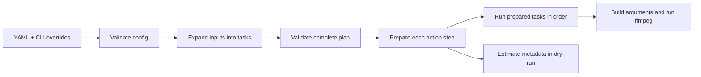

# Design patterns for MediaSmith

This guide explains the patterns used by the current YAML-to-ffmpeg pipeline and when to extend them. It is for contributors adding actions or changing planning and execution. The [code map](CODE_MAP.md) lists each file's responsibility, and [configuration guide](CONFIGURATION.md) describes YAML settings.

## Execution boundary

Configuration validation, planning, and execution are separate phases. A config can be structurally valid while its glob matches no files; `validate` checks the former, and `dry-run` or `run` checks both. Each task currently has one final output, and steps pass one primary intermediate file to the next step.

## Strategy with a registry

The action registry in `packages/core/src/ffmpeg/actions/index.ts` maps each YAML action name to an action definition. Each definition retains its strict Zod schema, ffmpeg argument builder, input and output media kinds, supported extensions, and action-specific hooks. The engine asks the registry for a definition instead of branching on action names. The TypeScript step union is inferred from the registry's schemas.

To add an action, create one module under `ffmpeg/actions/`, call `defineAction`, and register it in `index.ts`. Keep file matching in the planner and process launching in the executor. Action modules only describe and validate their own media operation.

## Prepare, then execute

`defineAction` provides two entry points:

- `tryPrepare(step)` returns either validation issues or a prepared step. The YAML schema uses it to report field errors.
- `prepare(step)` returns a prepared step or throws. Plan validation calls it once per shared step list, then reuses the prepared handlers across tasks that use that list. Each prepared step closes over typed options returned by Zod, so command building, output checks, and dry-run estimation use those options without reparsing them.

YAML validation and plan preparation are separate phases, so the plan checks its inputs independently. Callers pass prepared steps through execution instead of calling `prepare` for each method.

## Functional core and process shell

Calculations belong in functions that take values and return values. `compressionSettings.ts` resolves built-in defaults, job settings, profiles, and step options. `compressionMath.ts` calculates dimensions and bitrate without reading files or launching a process. These functions are straightforward to test with small inputs.

Filesystem work and child processes stay at the edges: `yaml/loader.ts` reads config files, `ffmpeg/ffprobe.ts` validates probed media, `engine/preflight.ts` checks source streams, `ffmpeg/executor.ts` runs ffmpeg, `engine/stepRunner.ts` renders one step, and `engine/taskRunner.ts` owns temporary files and cleanup. `compressVideo.ts` connects the calculations to ffmpeg arguments and checks the rendered output.

When adding a configurable value, define its shape in `yaml/settings.ts`, its built-in value in `ffmpeg/actions/defaults.ts`, and its resolution beside the action. Resolution order is step field, job setting, then built-in default. CLI `--set` changes a YAML field before validation; it does not change that resolution order.

## Pipeline contract

An action declares `inputKind` and `outputKind`. `engine/planValidator.ts` checks that consecutive steps are compatible and that the final output extension is supported. Task inputs have named `primary` and optional `externalAudio` roles. `engine/taskRunner.ts` passes each temporary output as the next step's primary input. `engine/stepRunner.ts` invokes the action's `validateOutput` hook on that step's rendered file before continuing.

Dry-run cannot probe a temporary file that was never rendered. Source preflight probes the original media, then dry-run calls each prepared action's `estimateProbe` hook to carry an estimate forward. Compression estimates scaled dimensions; merging external audio marks audio as present. A new action that changes metadata used by a later step must provide an estimator. If the estimate becomes unavailable, dry-run reports which step needs it. ffmpeg remains the source of truth for exact rendered metadata.

## Structured errors

`packages/core/src/errors.ts` defines `MediaSmithError`. Its `code`, `context`, and `cause` support programmatic handling; its message remains useful in the CLI.

| Code      | Owner                        | Useful context                           |
| --------- | ---------------------------- | ---------------------------------------- |
| `CONFIG`  | YAML loader and schema       | Config path and first invalid field path |
| `PLAN`    | Job planning and plan checks | Job name                                 |
| `TASK`    | Task runner                  | Task ID, step index, and action          |
| `PROCESS` | ffmpeg and ffprobe wrappers  | Command and exit code                    |

Wrap an error at the boundary where more context becomes known. Preserve the original error as `cause`, and avoid hiding field paths or ffmpeg output that help diagnose the failure.

## Process boundary and cancellation

`MediaProcessRunner` in `ffmpeg/processRunner.ts` has two operations: run ffmpeg and probe media. The engine uses the real implementation by default and accepts another implementation through `RunOptions` for focused tests. The same options carry an `AbortSignal` to both child processes. The CLI aborts on Ctrl+C; task cleanup runs before the command returns. Keep ffmpeg-specific details inside the process modules rather than action definitions.

## Patterns for later extensions

Add these only when the corresponding capability is being built:

| Need                                                    | Pattern                     | First change                                                                                 |
| ------------------------------------------------------- | --------------------------- | -------------------------------------------------------------------------------------------- |
| Resume, retry, or concurrent tasks                      | Explicit task state machine | Define task states and transitions before adding a manifest or worker pool.                  |
| Thumbnails, splitting, or other multiple-output actions | Artifact model              | Extend planned tasks and action results to describe each output before adding those actions. |

The current registry and single-output task model cover the implemented actions. Keep new interfaces as small as the feature that needs them.

### Proposed artifact model for multiple outputs

Before adding the first action that creates several files, extend the plan with explicit output artifacts. Each artifact should have a destination path, media kind (video, audio, image, subtitle, or report), and a role: `primary` for the file passed to the next step, or `side` for an additional result. A step such as thumbnail generation may produce only side artifacts; the planner must then say whether the original input continues to the next step.

The planner should reserve every destination path and reject collisions with inputs or other artifacts before execution. The runner should render outputs to temporary paths, verify the declared artifacts, publish them only after the step succeeds, and clean all temporary files on failure. Dry-run and future JSON reports should show the same artifact list. Existing version 1 jobs would still have one primary artifact, preserving their output mapping. Add a new YAML version only if the meaning of existing `output` or pipeline fields must change.

## Action contribution checklist

1. Define and register a strict action schema and argument builder.
2. Declare media kinds, extensions, probe, primary-audio, and external-input needs, and relevant hooks.
3. Add optional grouped settings and built-in defaults if the value should be configurable across a job.
4. Add tests for valid and invalid YAML, argument construction, dry-run metadata, and rendered media where behavior depends on ffmpeg.
5. Add a template, update the configuration and code map docs, and run `npm test`.

See [ARCHITECTURE.md](ARCHITECTURE.md) for the current flow and limits, and [CONTRIBUTING.md](CONTRIBUTING.md) for setup and compatibility rules.
